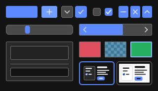
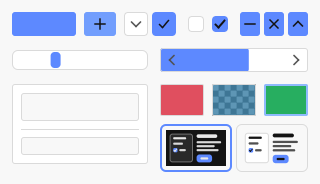

# Koebi

[](https://github.com/Kolosta/Koebi/actions/workflows/ci.yml)

Koebi is a cross-platform application written in Rust that draws its entire interface with its
own Vulkan renderer: widgets, canvases and compositing, with precise control over colors and
design tokens. SDL3 provides windows, input and the application lifecycle.

| Windows | Linux | macOS | Android | iOS |
|---|---|---|---|---|
| Vulkan | Vulkan | MoltenVK | Vulkan | MoltenVK |

 

*Golden test images: the first components, drawn only from design tokens, in two themes.*

## Status

The renderer draws anti-aliased rounded rectangles and strokes on all five platforms, with CI
running unit, integration, pixel, golden-image and end-to-end tests on each of them. The
design system is in place: typed tokens in three tiers, four themes, overrides per theme and
global, color vision simulation and correction, saved state, and import and export in the
W3C Design Tokens format. The window shows a [gallery](docs/design-system/gallery.md) of the
first components where every token edit shows in the same frame. Text and layout come next.

## Design

- **One rendering layer for everything**, like Blender's GPU module, but Vulkan-only and with
  zero-cost static dispatch ([why](docs/architecture/gpu-abstraction.md)).
- **Two runtime dependencies**: `ash` (Vulkan bindings) and `sdl3-sys` (SDL3 bindings).
  Everything else is written in-house ([ADR 0003](docs/adr/0003-minimal-dependencies.md)).
- **Colors as designers expect them**: sRGB values, gamma-space blending, OKLCH design tokens,
  WCAG contrast checks ([ADR 0004](docs/adr/0004-color-pipeline.md)).
- **Design tokens all the way down**: components read typed component tokens, compiled into
  the binary and resolved through themes and overrides in constant time
  ([design system](docs/design-system/README.md)).
- **Zero idle cost**: the app renders only when something changes.

```text
apps/koebi/            application (composition root) and design system gallery
crates/koebi-core/     geometry, color science, logging
crates/koebi-design/   design token engine: tiers, themes, overrides, color vision
crates/koebi-tokens/   Koebi's design tokens and built-in themes
crates/koebi-ui/       components drawn from design tokens
crates/koebi-gpu/      Vulkan render hardware interface
crates/koebi-render/   2D renderer (instanced SDF primitives)
crates/koebi-platform/ SDL3 platform layer
crates/koebi-testkit/  headless GPU and golden-image test tools
xtask/                 development automation (cargo xtask)
platform/              Android project, Apple bundle templates
```

## Quick start

Running a release package only needs a GPU driver with Vulkan 1.2. To build from source,
install Rust ([rustup](https://rustup.rs)), a C compiler, CMake and the
[Vulkan SDK](https://vulkan.lunarg.com/sdk/home) (details per OS in
[setup.md](docs/development/setup.md)), then:

```sh
git clone https://github.com/Kolosta/Koebi.git
cd Koebi
cargo xtask install-hooks
cargo run -p koebi                      # the gallery; add -- --theme light, --help...
```

Common commands:

```sh
cargo xtask ci                  # format, clippy, tests, docs, shaders, dependencies, spelling
cargo nextest run --workspace   # tests (or cargo test --workspace)
cargo xtask android             # Android APK (docs/development/platforms.md)
cargo xtask ios --run           # iOS simulator
cargo xtask help                # everything else
```

## Documentation

The docs are Markdown files: read them on GitHub or in your editor, and generate the API
reference with `cargo doc --workspace --no-deps --open` ([how](docs/README.md)).

- [Architecture overview](docs/architecture/overview.md) and
  [decision records](docs/adr/README.md)
- [Design system](docs/design-system/README.md), [components](docs/design-system/components.md)
  and the [gallery](docs/design-system/gallery.md)
- [Contributing](CONTRIBUTING.md), [gitflow](docs/development/gitflow.md),
  [coding standards](docs/development/coding-standards.md), [testing](docs/development/testing.md)
- [CI/CD](docs/development/ci-cd.md) and [platforms](docs/development/platforms.md)
- [Working with Claude Code](docs/ai/claude-code.md)

## License

No license has been chosen yet: until a `LICENSE` file is added, all rights are reserved by the
author.
