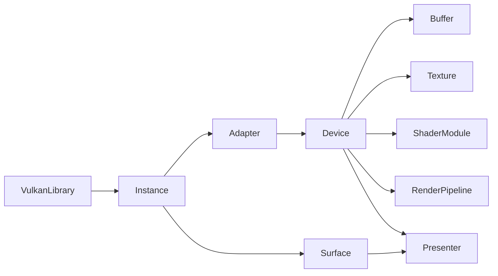

# GPU abstraction (koebi-gpu)

## The question: a Blender-style layer?

Blender renders its entire interface and viewport through its own `gpu` module, a C++ layer
with OpenGL, Vulkan and Metal backends behind a common interface (`GPUBatch`, `GPUShader`,
`GPUTexture`, immediate mode...). Koebi takes the same stance — *one in-house rendering layer
draws every pixel* — but deliberately changes three things.

| | Blender `gpu` module | Koebi `koebi-gpu` |
|---|---|---|
| Graphics APIs | OpenGL, Vulkan, Metal behind virtual backends | Vulkan only; MoltenVK on Apple |
| Why the layer exists | Portability between APIs, shared drawing utilities | Safety (RAII, deferred destruction) and ergonomics |
| Dispatch | Virtual calls per backend | Static, zero-cost (no trait objects) |
| Legacy | Immediate-mode heritage from OpenGL | Vulkan 1.3-era model: dynamic rendering, synchronization2 |
| UI drawing | Immediate mode plus small cached widget batches | Retained scene of instanced SDF primitives, few draws per frame |

**Why not multiple backends?** Vulkan runs natively on Windows, Linux and Android, and on macOS
and iOS through MoltenVK, which implements everything the baseline below needs on top of Metal.
A backend abstraction would double the code to test for no reach gain, and would force a
lowest-common-denominator API. If MoltenVK ever blocks us, a Metal backend can be added *below*
this API without changing `koebi-render` (see [ADR 0001](../adr/0001-vulkan-only-rhi.md)).

**Why not use wgpu or another engine?** They are excellent but heavy, bring large dependency
trees and their own abstractions; Koebi wants full control of memory, synchronization and color
handling with two runtime dependencies ([ADR 0003](../adr/0003-minimal-dependencies.md)).

## Baseline

Vulkan 1.2 plus `VK_KHR_dynamic_rendering` and `VK_KHR_synchronization2`, which are core in
Vulkan 1.3. Adapters reporting 1.3 use the core entry points; 1.2 adapters (older Android
drivers) use the KHR extensions through the same `DeviceShared::cmd_*` dispatchers. This keeps
the API modern (no render pass objects, explicit sync2 barriers) while staying compatible with
drivers that predate Vulkan 1.3 but expose both extensions, which is common on Android.

## Object graph

- **VulkanLibrary**: opens the loader at runtime (~100 lines of FFI instead of `libloading`).
  Windowed apps let SDL open it and pass `vkGetInstanceProcAddr` in, so both share one loader.
  On iOS, MoltenVK is linked statically by `build.rs`.
- **Instance**: validation layers (with synchronization validation) when requested; a debug
  messenger counts errors and warnings (`validation_report`), which tests and the app's exit
  code check.
- **Adapter**: probes version, extensions, features and a graphics+present queue; selection by
  preference (discrete first) or forced with `KOEBI_ADAPTER=<substring>`.
- **Device**: one queue for everything (UI workloads are latency-bound), function dispatch for
  1.3/KHR paths, submissions numbered for deferred destruction, a blocking `submit_and_wait`
  for uploads, readback and tests.
- **Buffer / Texture / ShaderModule / RenderPipeline**: RAII, debug names, validation of
  descriptions before reaching Vulkan.
- **Presenter**: swapchain (UNORM formats first, FIFO by default), two frames in flight, one
  `render_finished` semaphore per swapchain image, recreation on resize or `OUT_OF_DATE`.

## Memory

One dedicated `VkDeviceMemory` per long-lived resource, plus host-visible streaming buffers per
frame in flight for per-frame data. A UI renderer has few long-lived resources (pipelines,
atlases), so this stays far below `maxMemoryAllocationCount`. A sub-allocator (TLSF) can be
introduced inside `memory.rs` without changing the public API once texture atlases and images
multiply.

## Synchronization model

- CPU ↔ GPU: one fence per frame slot; waiting for slot *i* proves frame *N - 2* finished.
- Swapchain: `image_available` (per slot) is waited at `COLOR_ATTACHMENT_OUTPUT`; the first
  barrier's source stage is the same stage, so the layout transition cannot start early.
- Readback: a `COPY → HOST` memory barrier makes copied data visible to the CPU after the fence.
- Queue access is serialized by a mutex (`vkQueueSubmit2`, `vkQueuePresentKHR`).

## Deferred destruction

Each submission gets an increasing index. Dropping a buffer, texture or pipeline queues its
handles tagged with `last_submitted + 1`; when a fence proves submission *k* finished, all
garbage tagged `≤ k` is destroyed (a fence signal covers all earlier work on the queue).
Consequence: user code may drop resources at any time, even right after recording commands
that use them.

## Safety boundary

Public functions are safe unless they accept raw Vulkan handles (`Instance::new` with a raw
`vkGetInstanceProcAddr`, `Surface::from_raw`). Raw handles are reachable through `handle()`
methods and the re-exported `vk` module as an escape hatch for future advanced code, never as
a requirement. Clippy denies unsafe blocks without `// SAFETY:` comments.

## Extending

- New object kinds: the `/gpu-resource` skill (`.claude/skills/gpu-resource/SKILL.md`).
- New 2D primitives: the `/render-primitive` skill.
- Next steps on the roadmap: descriptor indexing (bindless textures) for images and glyph
  atlases, a pipeline cache persisted to disk, timestamp queries for GPU profiling, and
  optional HDR swapchains (`VK_EXT_swapchain_colorspace`).
