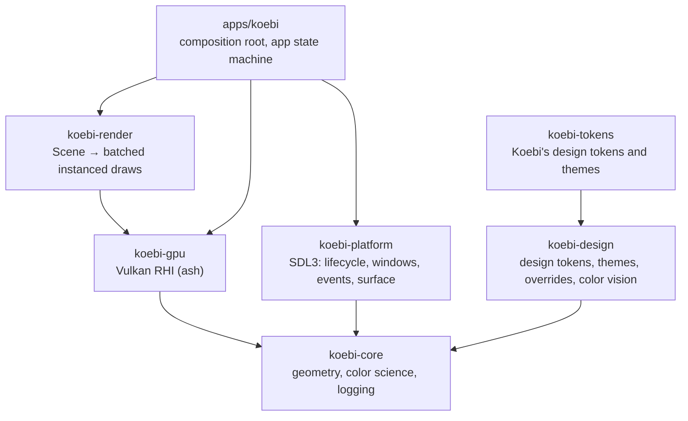
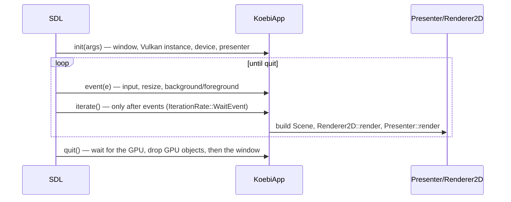

# Architecture overview

Koebi draws everything it shows: widgets, text, canvases and compositing go through its own 2D
renderer on Vulkan. The operating system only provides a window, input and a surface.

## Layers

| Crate | Responsibility | Depends on |
|---|---|---|
| `koebi-core` | `Vec2`/`Rect`/`Extent`, `Color` (sRGB, linear, OKLab, OKLCH, WCAG contrast), color vision matrices, logging facade | nothing |
| `koebi-gpu` | Vulkan loading, instance, adapter selection, device, memory, buffers, textures, pipelines, command recording, swapchain and frame pacing | `ash`, core |
| `koebi-render` | Retained `Scene` of 2D primitives, GPU instance layouts, shaders, batching | gpu, core |
| `koebi-platform` | SDL3 main callbacks (`App` trait), windows, event translation, Vulkan library and surface | `sdl3-sys`, `ash` (types), core |
| `koebi-design` | Design token engine: typed tokens in three tiers, compiled token tables, themes, overrides, views, color vision ([ADR 0008](../adr/0008-design-token-system.md)) | core |
| `koebi-tokens` | Koebi's token set and built-in themes ([design system](../design-system/README.md)) | design |
| `koebi-testkit` | Headless GPU, offscreen readback, PNG golden images (tests only) | gpu, core |
| `koebi` (app) | Wires the layers, owns application state, theme tokens | all |

Rules that keep the graph clean:

- `koebi-render` and `koebi-gpu` never see SDL; the app hands them raw Vulkan handles.
- `koebi-platform` never sees the renderer: it only produces events and surfaces.
- `koebi-core` has no dependency at all and no platform code, so it is testable everywhere,
  including under Miri.
- `koebi-design` knows neither the GPU nor the platform: it turns token definitions into
  values. Widgets map those values to render primitives.

Future crates slot in the same way: `koebi-text` (font parsing, shaping, glyph atlas),
`koebi-ui` (layout and widgets, styled by `koebi-design` tokens).

## Application lifecycle

SDL3 *main callbacks* drive the application (`koebi_platform::run`):

An idle UI consumes no CPU: SDL only calls `iterate` after an event. Tests and benchmarks use
`--frames N` to render continuously.

On Android, the native window disappears when the app goes to the background: the app drops the
presenter (swapchain and surface) on `WillEnterBackground` and recreates it on
`DidEnterForeground`.

## One frame

1. The app rebuilds the `Scene` (logical pixels; `Scene::clear` keeps its allocations).
2. `Presenter::render` waits for the frame slot's fence (frame *N - 2*), releases deferred
   garbage, acquires a swapchain image and opens a command buffer.
3. `Renderer2D::render` uploads instance data into the slot's streaming buffer, begins a
   dynamic rendering pass cleared to the scene's background and records one instanced draw per
   primitive run.
4. The presenter transitions the image for presentation, submits (signalling the image's
   `render_finished` semaphore and the slot fence) and presents.

## Ownership and destruction

Every Vulkan object is owned by exactly one Rust value and destroyed in `Drop`:

- children hold an `Arc` to their parent (`Buffer → Device → Instance`), so no drop order can
  destroy a parent first;
- objects the GPU may still use are queued with the index of the last submission that could
  reference them and destroyed once it completes (`garbage.rs`);
- the `Presenter` destroys its swapchain before its surface, and the app declares GPU state
  before the window so that surfaces die before native windows.

The result: dropping is always safe, and no code outside `koebi-gpu` calls `vkDestroy*`.

## Units and colors

- Logical pixels (`f32`) for layout; physical pixels (`u32`, `Extent`) for framebuffers.
  `physical = logical × scale_factor`, applied on the GPU.
- Colors are gamma-encoded sRGB with straight alpha (what designers pick), premultiplied at
  upload and blended in gamma space on UNORM targets so results match design tools
  ([ADR 0004](../adr/0004-color-pipeline.md)). Design tokens keep exact sRGB values; OKLCH
  serves editing and palette derivation ([ADR 0008](../adr/0008-design-token-system.md)).

## Errors and logging

Each library crate exposes an `Error` enum and a `Result` alias. Environment problems (no
Vulkan, GPU too old, no display) are distinguishable (`Error::is_unsupported_environment`) and
map to exit code 2; validation errors at exit map to exit code 3
(`koebi_platform::exit_code`). Logging goes through `koebi_core::log` (stderr, logcat on
Android), controlled by `KOEBI_LOG`.
