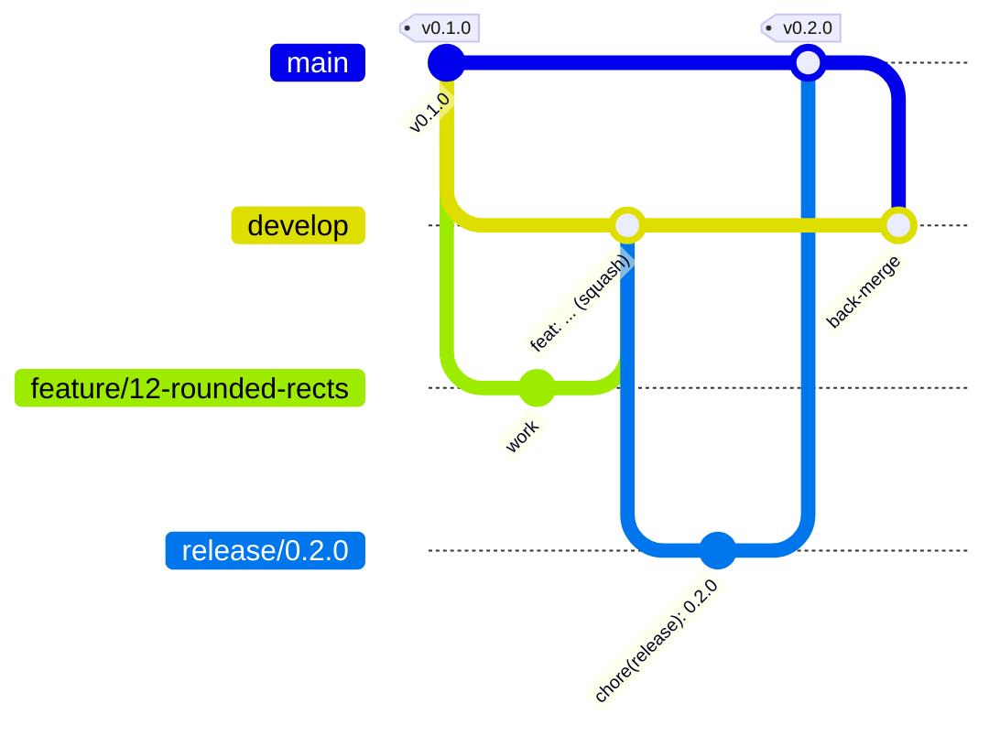

# Gitflow

Koebi follows gitflow ([ADR 0007](../adr/0007-gitflow-and-delivery.md)). Branch rules live in
`xtask/src/gitflow.rs` and are checked by the `pre-push` hook and the `PR policy` workflow.



## Branches

| Branch | From | Pull request into | Merge method |
|---|---|---|---|
| `main` | | | released code only, tagged `vX.Y.Z` |
| `develop` | `main` | | integration, default branch |
| `feature/<slug>` | `develop` | `develop` | squash |
| `bugfix/<slug>` | `develop` | `develop` | squash |
| `release/X.Y.Z` | `develop` | `main` | merge commit |
| `hotfix/X.Y.Z` | `main` | `main` | merge commit |
| back-merge `main` | | `develop` | merge commit (opened automatically) |

`<slug>` is lowercase letters, digits, `.`, `_` or `-`, ideally starting with the issue number:
`feature/42-text-shaping`. Bot branches (`dependabot/*`, `claude/*`) target develop.

Nobody pushes to `main` or `develop` directly: rulesets require a pull request and a green CI.

## Daily work

```sh
git switch develop && git pull --ff-only
git switch -c feature/42-text-shaping
# ... commits ...
git push -u origin HEAD
gh pr create --base develop --fill
```

Keep the branch current by merging `develop` into it, or by rebasing and pushing with
`--force-with-lease` (your own feature branch only).

In Claude Code, `/feature <issue or description>` and `/pr` do the same steps.

## Commits

[Conventional Commits](https://www.conventionalcommits.org): `type(scope): subject`, subject in
lowercase imperative, no final period. Aim for a header of 72 characters; the hook rejects more
than 100.

| Type | Use |
|---|---|
| `feat` | new capability |
| `fix` | bug fix |
| `perf` | performance improvement |
| `refactor` | internal change, same behaviour |
| `test` | tests only |
| `docs` | documentation only |
| `build` | Cargo, toolchain, dependencies |
| `ci` | GitHub Actions, CI scripts |
| `chore` | maintenance, releases |
| `revert` | revert a previous commit |
| `style` | formatting only |

Scopes name the area: `core`, `gpu`, `render`, `platform`, `app`, `testkit`, `xtask`, `ci`,
`android`, `ios`, `docs`. A breaking change adds `!` (`feat(gpu)!: ...`) and explains it in a
`BREAKING CHANGE:` footer.

Feature branches may contain any commits; the **pull request title** becomes the squash commit
on develop, so the title must follow the convention (checked by CI).

## Pull requests

- Fill in the template: summary, linked issue (`Closes #42`), how it was tested.
- Required checks: `CI result` and `PR policy result`. Review conversations must be resolved.
- Approvals required: 0 while the project has one maintainer; raise
  `required_approving_review_count` in `.github/rulesets/*.json` when the team grows.
- Squash-merge features and bug fixes. The head branch is deleted automatically.

## Releases

1. Branch `release/X.Y.Z` from an up-to-date develop.
2. `cargo xtask version X.Y.Z` (updates `Cargo.toml` and `Cargo.lock`).
3. Update `CHANGELOG.md` (`git cliff --tag vX.Y.Z -o CHANGELOG.md`).
4. Commit `chore(release): X.Y.Z`, push, open the pull request into `main`.
5. Only fixes land on the release branch. Merge with a merge commit.
6. The Release workflow then packages every platform, creates tag `vX.Y.Z` and the GitHub
   Release, and opens the `main` to `develop` back-merge pull request. Merge it with a merge
   commit.

Versions follow [SemVer](https://semver.org). While the version is `0.x`, breaking changes
bump the minor number.

In Claude Code: `/release X.Y.Z`.

## Hotfixes

1. Branch `hotfix/X.Y.Z` from `main` (patch version + 1).
2. Write the regression test, fix, `cargo xtask version X.Y.Z`, update the changelog.
3. Pull request into `main`, merge commit. Delivery and the back-merge are automatic.

In Claude Code: `/hotfix X.Y.Z`.

## Local hooks

`cargo xtask install-hooks` sets `core.hooksPath` to `.githooks/`:

| Hook | Check |
|---|---|
| `pre-commit` | `cargo fmt --all --check` |
| `commit-msg` | Conventional Commits header (`cargo xtask commit-msg`) |
| `pre-push` | refuses pushes to `main` and `develop`; validates the branch name |

The server-side rulesets enforce the same rules, so a skipped hook only delays the failure.
